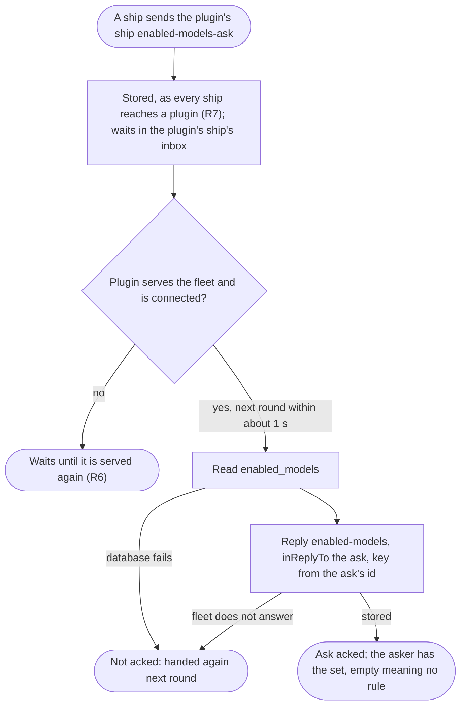
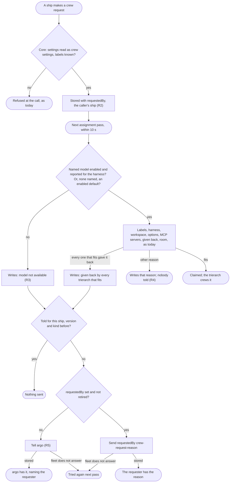

# Enabled models for ships: read, refused by the plugin, told why a request waits

Design for [#57](https://github.com/ThomasHendrickx/aeolus-fleet-trierarch-plugin/issues/57). Docs only. Status: purpose agreed by Thomas (8 Nov); Q1 to Q6 answered; the rules, flows and slices wait for his approval for his answers, and no rule below is decided until he answers.

## 1. Purpose (agreed by Thomas, 8 Nov)

A ship that asks for crews learns, without a person, what the fleet lets it ask for and why a request of its own is not crewed (Thomas, 8 Nov: "That is a trierarchs plugin issue to fix").

For whom: every ship that makes crew requests (an orchestrator, squadrons forming a squadron, a session through MCP or REST). Second: the operator, who today is the only one who sees why, by reading the console.

A good outcome:
1. A ship with crew rights reads the fleet's enabled models (decision [0063](../decisions/0063-model-governance.md)) through the fleet, as the console does with `models.list`.
2. A crew request that names a model the fleet does not enable is refused when it is made, with the reason, never answered OK and left at awaitingCrew (seen 7 and 8 Nov with `gpt-5.6-terra`).
3. When every trierarch that fits gives a request back, the ship that made the request gets a message with the reason, rather than the request sitting at awaitingCrew with the reason only on the console.
4. A fleet with no enabled models behaves as today (0063: an empty set is no rule).

Not the purpose: changing what placement picks or the rules of 0063; stopping or moving a running or assigned crew (0063, 0030); the console's crew forms, which already leave disabled models out; telling argo when the enabled models change ([aeolus-fleet#1256](https://github.com/ThomasHendrickx/aeolus-fleet/issues/1256)), unless Thomas widens outcome 3 (Q4).

## 2. Lessons to check against

| # | Lesson | Source |
| --- | --- | --- |
| L1 | Core already refuses, at `crewRequest`, a request no trierarch could ever take (settings that are not crew settings, an unknown label value): "a request no trierarch could ever take must not be answered OK and then wait unseen". Outcome 2 is the same promise for a disabled model. | aeolus-fleet 0029; aeolus-fleet#809, #811 |
| L2 | Core never acts on crew settings and accepts a request naming any model; the trierarch plugin, which alone places, is the one guard. 0063 rejected the enabled models as a fleet setting in core. A refusal made by core at the call touches that rejection, so it is a question (Q1), not a choice made here. | 0063; aeolus-fleet 0029 |
| L3 | Aeolus knows nothing about the trierarch plugin beyond its ship, and plugins that know each other were rejected. Core cannot ask the plugin during `crewRequest`. | [0030](../decisions/0030-trierarch-plugin.md) |
| L4 | Crew state in a plugin's own database was rejected because requesters would have to know the plugin. Requests stay with core; a read of the models that goes to the plugin's ship makes requesters know the plugin. | aeolus-fleet 0029, Rejected |
| L5 | A request that names no model fits only a trierarch whose reported default for the harness is enabled; only placement knows the reports. A refusal at the call can cover a named model only: a request naming none still waits with `model disabled: no enabled default model for <harness>`. | 0063; `core/assignment/placement.ts` |
| L6 | Only placing is checked, and a change takes effect at the next assignment pass. A request accepted before its model is disabled still waits with `model disabled: <id>`, so a refusal at the call never covers every case. | 0063 |
| L7 | The crew request records no requester: the settings, version, assignment, status, reason and give-backs only. "The ship that made the request" exists in the event log at most. Who crewed it is derived, never stored. The ship's owner is recorded (0045). | common `schemas/crew-request.ts`; aeolus-fleet 0029 |
| L8 | With network rules applied, a send needs a rule or a built-in. The plugin's ship declares only `trierarch=*` to `trierarch=*`; the answer built-in covers only a reply (inReplyTo); argo and the owner built-ins cover only those ships. A message from the plugin's ship to any requester can be refused `NOT_REACHABLE`. | aeolus-fleet 0034, 0037 |
| L9 | No human passes messages or watches flags: the operator is not the fail-safe. Today only the console's needs-crew to-do shows why a request waits. | blueprint, promise 2 |
| L10 | When every trierarch that fits gave a request back, placement writes `given back by every trierarch that fits; last: <reason>` (`CrewRequestExplained`), rewritten only when it changes. The give-back records are cleared on every new settings version. | `core/assignment/placement.ts`; aeolus-fleet 0029, #382 |
| L11 | The plugin already tells argo once per ship, settings version and stated model when a stated model differs from the request's, storing the notice once under its idempotency key, so a restart tells nothing again. | `core/assignment/tell-model-mismatches.ts` |
| L12 | Requests reach core through the console, MCP, REST and squadron templates (`crew.model`): squadrons is a requester too. | 0063 design L10; aeolus-fleet 0004 |
| L13 | The plugin calls only what aeolus-fleet's `docs/compatibility.md` lists; a new call is listed there and `MINIMUM_CORE_VERSION` is raised in the same PR. Before 1.0.0, no compatibility work. | CLAUDE.md; aeolus-fleet 0013 |
| L14 | Every signed-in session reads the set, viewer included (`models.list`); only changing it takes `fleet:manage`. | 0063 |

## 3. Questions

Sent to Thomas on Bridge, each with a pick and a "none of these" option. The rules, flows, repositories and slices follow from his answers.

- **Q1. Where is a request for a disabled model refused?** Answered (Thomas, 8 Nov): option 2, by the plugin, never in core. The request is accepted; the plugin's next assignment pass (within 10 s) writes the reason and tells the requester (Q3). Why: "Writing models to core would mean the plugin logic leaks into core plus the plugin needs to update core and we get 2 sources of truth. A model can change both due to selection changing and by the updates of the harnesses on the different trierarchs. That would introduce race conditions." So outcome 2 reads: refused by the plugin's next pass, with the reason told to the ship that asked.
- **Q2. How does a ship read the enabled models?** Answered (Thomas, 8 Nov): a message to the plugin's ship, answered as a reply with the exact set as it is now; a content type in common for each. With network rules applied, the requester needs a rule that lets it reach the plugin's ship; the reply goes back by the answer built-in.
- **Q3. Who is told, and by whom?** Answered (Thomas, 8 Nov): option 1. Core records the requester on the crew request (the ship that last made it), and the plugin's ship sends it the reason once per settings version, with a declared rule that lets the plugin's ship send to requesters. Q6 makes it a built-in instead.
- **Q4. Which reasons are told?** Answered (Thomas, 8 Nov): option 1, the model reason and the give-back reason, each once per settings version. His note: a model that is disabled and a model no trierarch reports are the same to the requester: "Is just is not available".
- **Q5. Screens.** Answered (Thomas, 8 Nov): option 1. No console screen changes, so no mockups: the console's forms already leave disabled models out and the crew request card already shows the reason.

- **Q6. In a fleet with network rules, how does the plugin reach requesters?** (asked after Q3: 0037 lets a plugin declare rules only on labels it owns, so Q3's declared rule cannot be.) Answered (Thomas, 8 Nov): none of the options; "plugins are always reachable": every ship sends to a ship of kind plugin, and a ship of kind plugin sends to every ship. Two built-in rules in core, beside 0034's built-in read of a plugin, so nothing is declared.

## 4. Rules (from the answers; for Thomas to approve)

| # | Rule |
| --- | --- |
| R1 | **Asking the plugin's ship for the enabled models** (Q2). Any ship sends the trierarch plugin's ship a message of content type `application/vnd.aeolus.trierarch.enabled-models-ask+json`, payload `{}`. The plugin answers it in its inbox round (about 1 s) as a reply (inReplyTo), content type `application/vnd.aeolus.trierarch.enabled-models+json`, payload `{"models":["<exact id>"]}`, sorted: the fleet's set as it is when answered, read from `enabled_models`. An empty list means no rule: every model is allowed (0063). No scope is checked, as every session reads the set (L14). The reply's idempotency key is made from the ask's message id, and the ask is acked only after the reply is stored, so a crash answers again and the fleet stores the reply once. Both shapes are schemas in common. The ask is never refused by the network: every ship reaches a plugin (R7). |
| R2 | **The requester on the crew request** (Q3). Core records, on every `crewRequest`, the ship that made it: the caller's ship (for the console, the ship the session acts as). It is listed with the request as `requestedBy` (`{ id, name }`, null for a request made before it was recorded), replaced by every new request, and removed with the request. The console shows nothing new (Q5). |
| R3 | **A model that is not available** (Q4, Thomas's note). Placement, before any trierarch is picked, writes `model not available: <id>` for a request whose named model (`options.model`) is outside a non-empty set of enabled models, or that no trierarch offering the request's harness reports. A request naming none, where no trierarch left reports an enabled default for the harness, waits with `model not available: no enabled default model for <harness>`. These replace 0063's `model disabled` reasons; the check before a request answers the same, with the field `options`. The rest of placement is unchanged. |
| R4 | **Telling the requester** (Q3, Q4). When an assignment pass writes a reason of R3 or the give-back reason (`given back by every trierarch that fits; last: <reason>`) on a request, the plugin's ship sends `requestedBy` a message of content type `application/vnd.aeolus.trierarch.crew-request-reason+json`, payload `{"shipId","shipName","settingsVersion","reason"}`, a schema in common. Once per ship, settings version and kind (model or given back): the idempotency key is made from the three, so a restart and a rewritten reason tell nothing again, as the model mismatch tell does (L11). Other reasons are not told. |
| R5 | **When there is no requester to tell.** A tell for a request with no `requestedBy`, or whose requester is retired, goes to argo instead, once under the same kind of key, as a message that opens with its headline (`argoMessage`) and names the ship, the requester and the reason. A tell the fleet does not answer is tried again by the next pass. The pass goes on either way. |
| R6 | **Switched off, or not connected.** The plugin's ship takes no messages for a fleet it does not serve: an ask waits in its inbox and is answered once the fleet is served again, as any message waits. Nothing is placed, so nothing is told. |
| R7 | **Plugins are always reachable** (Q6). Two built-in send rules in core, never off, shown first with the others (0034): every ship to every ship of kind plugin, and every ship of kind plugin to every ship. 0034 amended. |

## 5. Flows

### Asking for the enabled models

### Placing a request and telling the requester

### The requester makes a new request

A new settings version clears the give-back records (0029) and makes a new key: its next reason is told again. Enabling the model places the request at the next pass; nothing is told for that.

## 6. Repositories and slices

- **aeolus-fleet (core and common):** `requestedBy` on the crew request (R2) and decision 0029 amended; the two built-in send rules for plugins (R7) and decision 0034 amended; the three content types' schemas in common (R1, R4); `docs/compatibility.md` naming the core version the trierarch plugin needs for `requestedBy`. No enabled models in core (Q1).
- **aeolus-fleet-trierarch-plugin:** answering the ask (R1), `model not available` (R3), telling the requester or argo (R4, R5); decision 0063 amended; `MINIMUM_CORE_VERSION` raised in slice 4.
- **aeolus-fleet-trierarch:** docs only, the reasons in `docs/trierarch.md`, "Assignment" (R3).

Slices, each ending on its tests by name:

1. **Core and common: the requester, plugins always reachable, and the content types** (aeolus-fleet). Tests: in a fleet with its own rules applied, a ship with no rule sends to a plugin's ship and a plugin's ship sends to it, and neither built-in can be turned off; `crewRequest` records the caller as `requestedBy` and a new request replaces it; a request made in the console records the session's ship; the list and the request's page carry it; the three schemas take and refuse their shapes.
2. **The plugin answers an ask** (this repository), after slice 1's common release. Tests: the set answered as a reply, empty as no rule; a crash after the reply answers once; a database failure leaves the ask unacked; a fleet not served leaves it waiting.
3. **Model not available** (this repository and aeolus-fleet-trierarch's docs). Tests: placement and the check for a named model disabled, one no trierarch offering the harness reports, none named with no enabled default; a fleet with no rule.
4. **The plugin tells the requester** (this repository), after slice 1's core release. Tests: told once per ship, version and kind, across a restart and a rewritten reason; a new settings version told again; other reasons not told; a retired requester and no requester told to argo; the fleet not answering tried again next pass.
