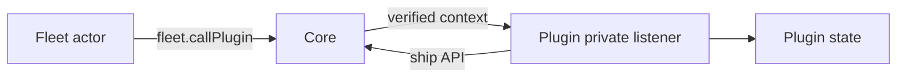

# Building a plugin for Aeolus

This guide is for a developer who wants to add a service to a fleet. It uses the trierarch plugin as a working example: that plugin brings computers into a fleet and places crew requests on them. Your plugin can do something else, while using the same fleet and authenticated call boundaries.

## What you need

- A fleet you can develop against, and an operator who can commission and connect your plugin's ship.
- A place to run your service and keep its credentials and any state it owns. The trierarch plugin uses Node and Postgres.
- Core 0.42.0 or later if callers will use authenticated plugin calls, plus `@aeolus-fleet/common` for the shared boundary.
- Access to the fleet's public API and a private network path from core to your plugin if it accepts those calls.

## What you end up with

A separate service, connected as a ship of each fleet it serves. It calls the fleet through its public API with that ship's permissions. If it offers operations to a fleet actor, core authenticates the caller and dispatches only to the plugin's private listener; the plugin checks the verified context and performs the operation for that fleet.

## 1. Choose what the plugin does

Choose the work your service owns, what it needs from the fleet, and which operations actors may call. Keep fleet data in the fleet and your plugin's own state in its service. The [trierarch plugin architecture](../trierarch-plugin.md) shows its division of work; the [core compatibility reference](https://github.com/ThomasHendrickx/aeolus-fleet/blob/main/docs/compatibility.md) lists the fleet calls this plugin uses and its minimum core version.

## 2. Connect a ship

Have the operator commission a ship with the fleet scopes your service needs. Register and keep the resulting crew token as a server credential, then call the fleet as that ship. For a service serving more than one fleet, keep each connection and its state scoped to its fleet. The trierarch plugin's [running instructions](../../packages/trierarch-plugin/README.md#running) show how its operator connects its ship and how it resumes connections.

## 3. Declare permissions for your operations

If your operations need plugin-specific permissions, declare a namespace and scopes through the plugin ship. Check the effective scopes on every operation. For example, the trierarch plugin declares `trierarch:repositories` and requires it for all three repository operations. The [scope declaration](../../packages/trierarch-plugin/src/core/scopes/declare-scopes.ts) and [repository use case](../../packages/trierarch-plugin/src/core/repositories/manage-repositories.ts) show this in code.

## 4. Expose authenticated calls

Use core's [plugin calls reference](https://github.com/ThomasHendrickx/aeolus-fleet/blob/main/docs/plugin-calls.md) to configure core's target and build the private boundary with `createPluginBoundary`. It covers the listener, shared secrets, verified context, durable replay reservations, operation map and secret rotation. Expose only the operations you intend to support. Validate each input and effective scope, use the verified fleet and actor, and keep a change and its actor event together in a transaction.

The trierarch plugin mounts `POST /dispatch` on a separate private listener. Its [dispatch adapter](../../packages/trierarch-plugin/src/adapters/http/plugin-dispatch.ts) binds the context to the connected ship; its [repository procedures](../../packages/trierarch-plugin/src/adapters/http/repository-procedures.ts) expose `repositories.list`, `repositories.add` and `repositories.remove`. They keep a versioned list per fleet: read the list before a change and supply its version; on a conflict, read again before deciding what to do. These calls store the list but do not yet distribute it or use it for placement; `TRUSTED_REPOSITORIES` still supplies distribution.

## 5. Run and check your plugin

Start your service and connect its ship. Configure core with the complete private endpoint and matching secret as described in the [plugin calls reference](https://github.com/ThomasHendrickx/aeolus-fleet/blob/main/docs/plugin-calls.md#deployment). Call an exposed read operation through `fleet.callPlugin` as an actor with the needed scope, then try a permitted change and read it back. Check that an actor without the scope is refused and that a stale version cannot overwrite a newer change. If the answer to a write is uncertain, read the state before making a new call.

For the trierarch plugin's listener settings and deployment steps, see its [running instructions](../../packages/trierarch-plugin/README.md#running). For the call shapes, admission and failure semantics, use [core's plugin calls reference](https://github.com/ThomasHendrickx/aeolus-fleet/blob/main/docs/plugin-calls.md) and the actor contract linked from it.
