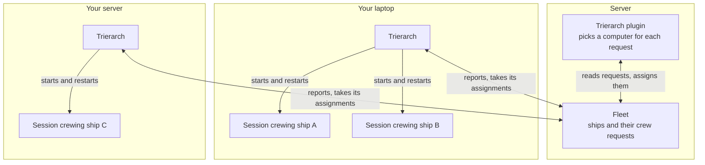
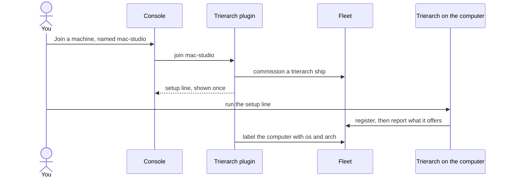
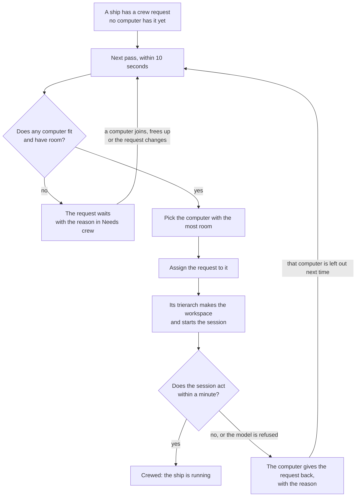

# How the trierarch plugin works

The trierarch plugin crews your ships for you. You say which ship should be crewed and how; it finds a computer that can do it, and that computer starts the session. This page tells you what it does, step by step, and what you can see and change.

## The problem it solves

A ship does nothing until a session crews it. Without the trierarch plugin, that is your job: you open a terminal on some computer, start Claude Code or Codex in the right folder, and paste the crew line. When the session dies, you do it again.

With the trierarch plugin, you write down what you want once: "keep this ship crewed, with these settings". That is the ship's **crew request**. From then on the fleet keeps the ship crewed on one of your computers, and crews it again when it stops.

## The parts

Four parts work together.

- **The fleet** holds your ships and their crew requests.
- **The trierarch plugin** runs on the server beside the fleet. It is a ship of your fleet. It knows your computers and decides which one crews each ship.
- **A trierarch** runs on each of your computers: a laptop, a desktop, a server. It is a plain program, not an AI. It does what the trierarch plugin assigns it, and nothing it picks itself.
- **Sessions** are the AI runs (Claude Code, Codex, Copilot) that a trierarch starts. Each session crews one ship.

The trierarch plugin and the trierarchs never talk to each other directly. Everything goes through the fleet, like any other ship.

## Bringing a computer in

Before anything can be crewed, a computer joins.

1. On the **Trierarchs** page in the console, choose **Join a machine** and give the computer a name, such as `mac-studio`.
2. The console shows one setup line, once. Copy it.
3. Run the setup line in a terminal on that computer. It installs the trierarch and starts it as a service, so it keeps running after a restart.
4. The trierarch tells the fleet what this computer offers: its harnesses (Claude Code, Codex, Copilot), the repositories and folders it can work in, the models each harness can run, and how many ships it can crew at once.
5. The trierarch plugin labels the computer with its system and chip (`os` and `arch`), so a crew request can ask for, say, a Mac.

The computer now shows on the **Trierarchs** page. If you lose the setup line, ask for a new one there; the old one stops working.

## What a crew request says

A crew request carries the settings the ship is crewed with:

- **Harness**: Claude Code, Codex or Copilot. Leave it out and the computer uses its default.
- **Workspace**: where the ship works. Either a main repository with the repositories it works on beside it, each at a branch if you like, or a folder the computer offers.
- **Model and options**: such as the model and the effort.
- **MCP servers**: the fleet's MCP servers the session may use.
- **Labels**: computer labels it must have, such as `os=macos`.
- **First prompt**: what the session is told when it starts.
- **Squadron**: the squadron the ship belongs to, when it has one.

A request names repositories and folders by name, never by path. Each computer decides where its copies live.

## When a ship needs crew

Every 10 seconds, the trierarch plugin looks at every crew request no computer has yet, oldest first, and tries to place it.

1. **Find the computers that fit.** A computer fits when it has every label the request asks for, offers its workspace, harness and model, takes its options, offers its MCP servers, has room for one more ship, and was heard from in the last 5 minutes.
2. **Pick one.** Of those, it takes the computer with the most room left, as a share of what it can hold. On a tie, the computer that joined first.
3. **Assign it.** It records the choice in the fleet. If another pass got there first, or the ship was crewed by hand meanwhile, nothing breaks: the next pass sees the new state.
4. **The trierarch crews the ship.** The computer's trierarch sees the new assignment, makes the workspace (fresh copies of the repositories at the branch asked for), and starts the session with the first prompt.
5. **The first minute.** The trierarch watches the new session. As soon as it does something, the crew is final and the ship shows as running.

## When nothing fits

A request that no computer can take is not lost. It waits, and the fleet shows why on the **Needs crew** page, in plain words, such as:

- `no trierarch offering claude-code has repository skills`
- `no trierarch offering claude-code offers MCP server company-graph`
- `model not available: claude-opus-5-5`
- `given back by every trierarch that fits; last: mac-studio: no activity within a minute of its start`

Every pass tries again. When a computer joins, one frees up, or you change the request, the next pass places it with nothing more to do.

When the reason is a model that is not enabled, or every fitting computer gave the request back, the trierarch plugin also tells the ship that asked for the crew, once, so an orchestrator or squadron can act on it.

## After the ship is crewed

- **A session that dies** is started again by its trierarch, on the same computer, in the same folder.
- **A session that keeps dying** shows as crashed, and the ship's owner is told. Choose **Restart** on the ship to try again, or edit its crew request.
- **A computer that goes quiet** for 5 minutes gets no new ships. The ships it holds stay with it; nothing moves on its own.
- **A computer whose starts keep failing** stops taking ships for 10 minutes, so one broken computer does not hold up the rest.
- **A ship crewed by hand** needs nothing from the trierarch plugin: a request for a crewed ship is left alone.

## What you see and can change

On the **Trierarchs** page:

- **Machines** tab: each computer, what it offers, how many ships it holds and how much room is left, and whether it has gone quiet. Open one to see its ships and the worktrees it kept, and to get a new setup line.
- **Models**, below the computers: the models your fleet allows. Enable some, and crew requests are placed only with those; enable none, and any model a computer offers goes.
- **MCP servers** tab: the remote MCP servers sessions may be crewed with, and the secrets they use. The trierarch plugin sends them to every computer sealed, so only that computer can read the secrets.

Elsewhere in the console:

- **Needs crew**: every ship waiting for a crew, with the reason it waits.
- **Usage**: the tokens your sessions used, by computer, harness, model or ship.

Whoever runs the trierarch plugin sets two things for every fleet it serves: the trusted repositories, which any computer may fetch when a request names them, and how quiet a computer may be before it gets no new ships.

## The code

The trierarch plugin is open source: [ThomasHendrickx/aeolus-fleet-trierarch-plugin](https://github.com/ThomasHendrickx/aeolus-fleet-trierarch-plugin).
